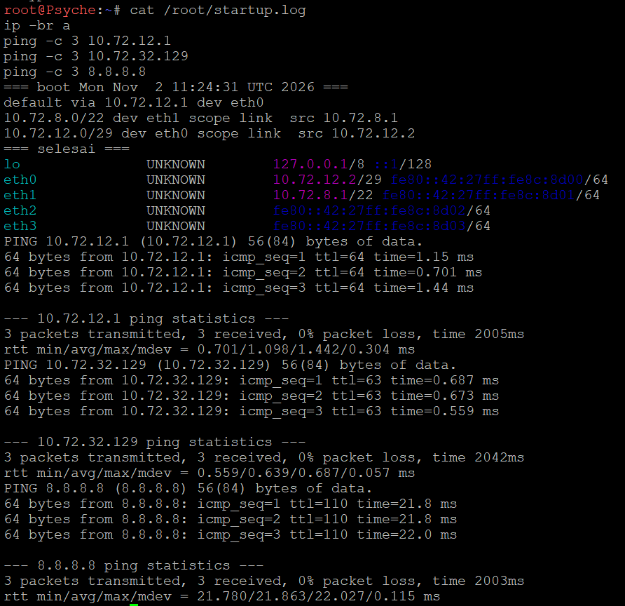
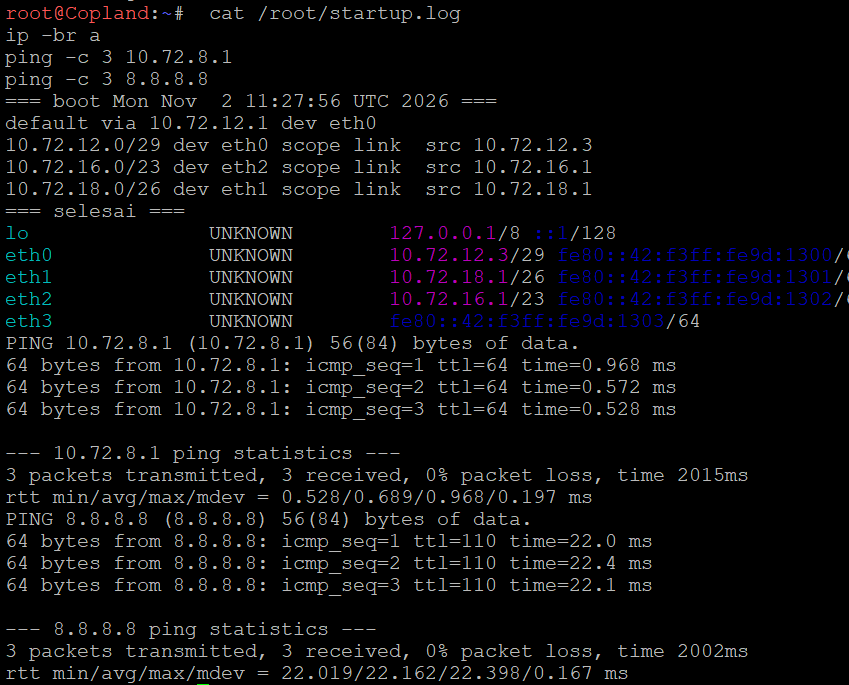
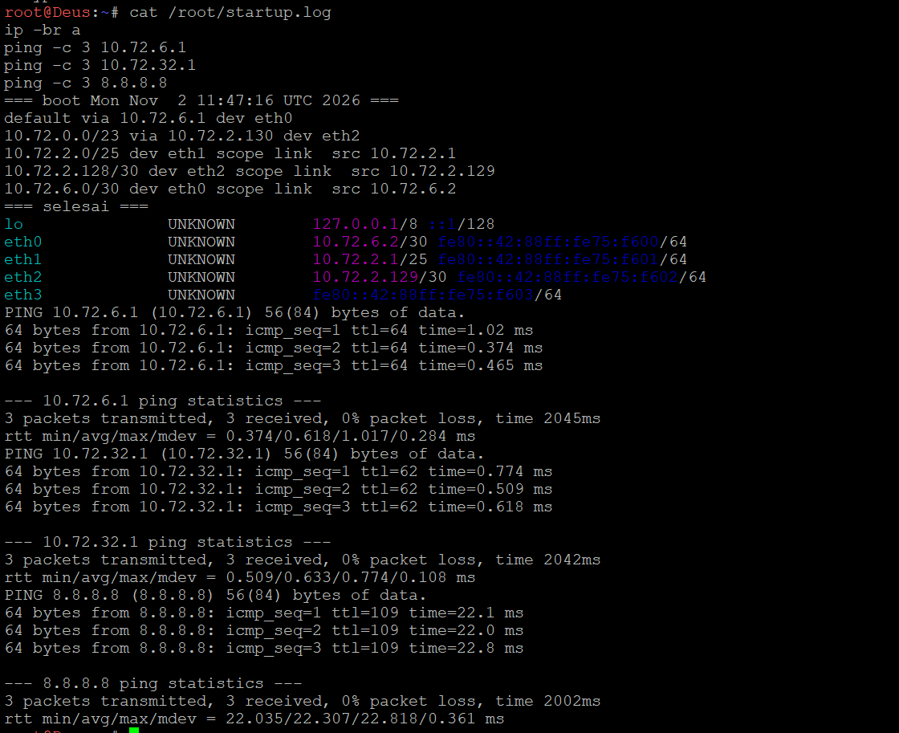
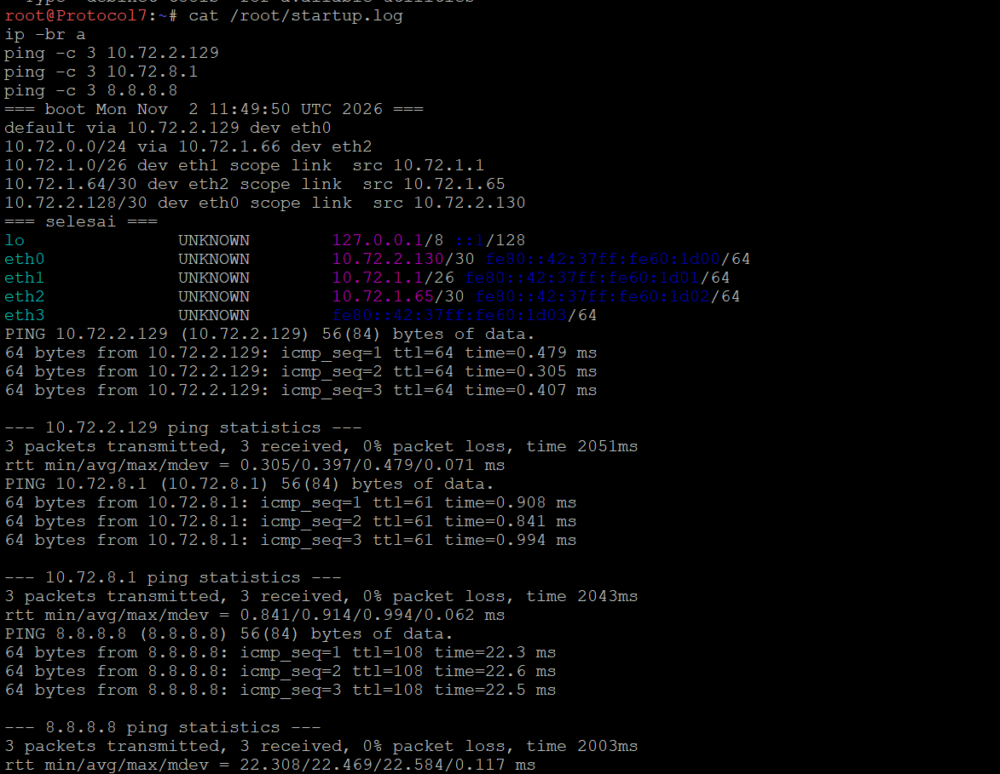
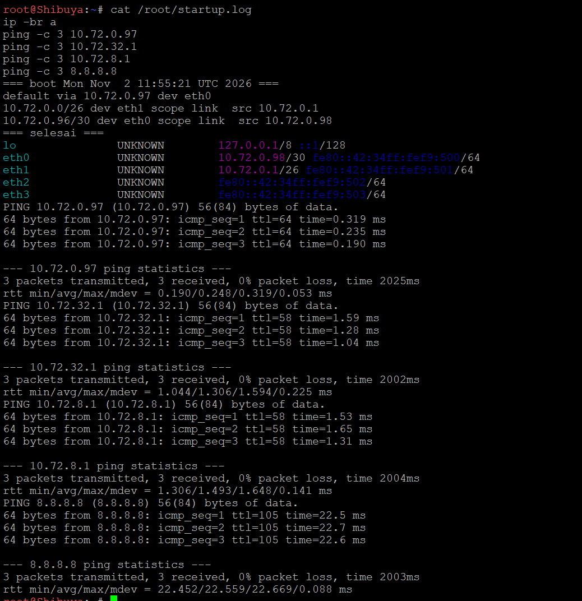
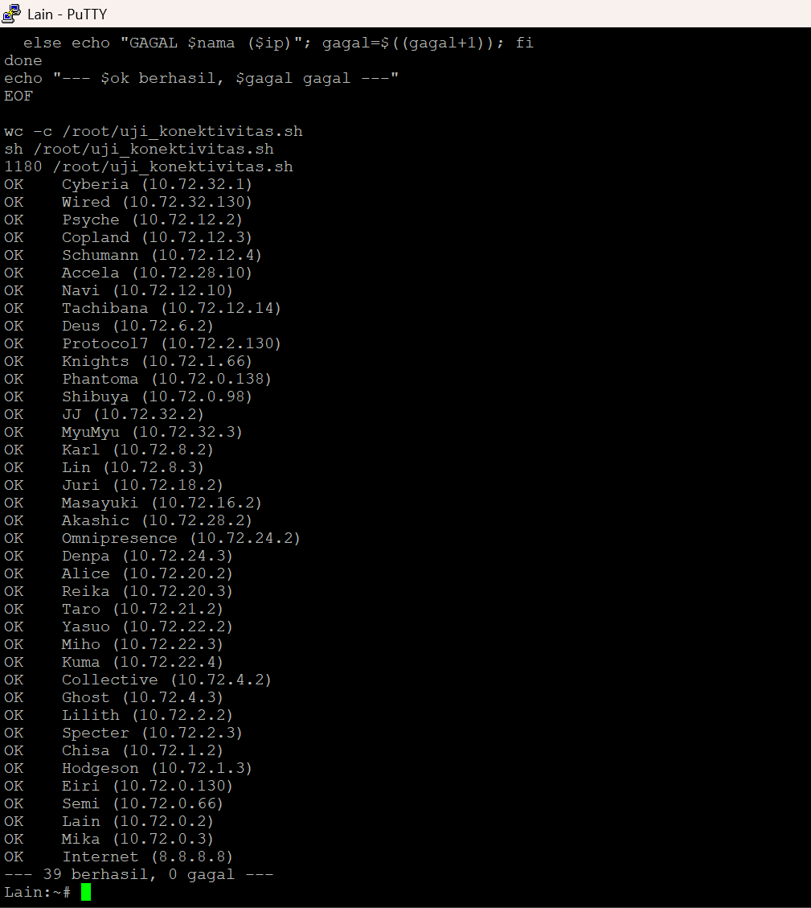

# PRAKTIKUM JARKOM MODUL 4 KELOMPOK K17 - 2026

## Anggota Kelompok

| Nama | NRP |
| --- | --- |
| Dian Piramidiana Rachmatika | 5027251031 |
| Jude Athala Yazid Sari | 5027251098 |

## Laporan

[SPREADSHEET PERHITUNGAN](./Subnetting%20Modul%204%20-%20K17.xlsx)

Prefix IP kelompok K17: **10.72.x.x**. Topologi berisi 13 router, 13 switch, dan 25 node. Hanya **Cyberia** yang terhubung ke NAT (GNS3) / Cloud (CPT). Jumlah IP setiap subnet = jumlah host + jumlah interface router pada subnet tersebut.

| File | Isi |
| --- | --- |
| [`Subnetting Modul 4 - K17.xlsx`](./Subnetting%20Modul%204%20-%20K17.xlsx) | Template spreadsheet: rute subnet, VLSM, penggabungan CIDR, pembagian IP CIDR |
| [`projects/`](./projects) | Export project GNS3 (`K-17-MODUL-4.gns3project`) dan file Cisco Packet Tracer (`.pkt`) |
| [`routings/gns3/`](./routings/gns3) | Script per node GNS3 + kumpulan script per sayap |
| [`routings/cpt/`](./routings/cpt) | Static route per router CPT |
| [`Assets/`](./Assets) | Gambar topologi, pohon, tabel, dan screenshot pengujian |

### Rute Subnet

Terdapat **25 subnet** (A1–A25) dengan total kebutuhan **2814 IP**.

### CPT - VLSM

1. Berikut topologi yang dibuat untuk Cisco Packet Tracer.

   

2. Total penggunaan subnet.

3. Static routing.

### ==== Cyberia ====
ip route 10.72.0.0 255.255.192.0 10.72.20.130     # H1: semua di belakang Wired

### ==== Wired ====
ip route 0.0.0.0 0.0.0.0 10.72.20.129             # default ke Cyberia (arah NAT)
ip route 10.72.8.0 255.255.252.0 10.72.21.2       # A6: LAN Psyche
ip route 10.72.12.0 255.255.252.0 10.72.21.3      # B9: cabang Copland
ip route 10.72.0.0 255.255.248.0 10.72.21.4       # C3: cabang Schumann + Accela
ip route 10.72.16.0 255.255.252.0 10.72.18.66     # C2: cabang Navi
ip route 10.72.32.0 255.255.240.0 10.72.42.2      # G1: cabang Tachibana

### ==== Psyche / Copland / Schumann (default ke Wired) ====
ip route 0.0.0.0 0.0.0.0 10.72.21.1               # Psyche, Copland, Schumann: sama semua

### ==== Schumann (tambahan) ====
ip route 10.72.0.0 255.255.252.0 10.72.4.10       # A11: LAN Accela

### ==== Accela ====
ip route 0.0.0.0 0.0.0.0 10.72.4.9                # default ke Schumann

### ==== Navi ====
ip route 0.0.0.0 0.0.0.0 10.72.18.65              # default ke Wired

### ==== Tachibana ====
ip route 0.0.0.0 0.0.0.0 10.72.42.1               # default ke Wired
ip route 10.72.32.0 255.255.248.0 10.72.36.130    # F1: semua di belakang Deus

### ==== Deus ====
ip route 0.0.0.0 0.0.0.0 10.72.36.129             # default ke Tachibana
ip route 10.72.32.0 255.255.252.0 10.72.34.66     # E1: semua di belakang Protocol7

### ==== Protocol7 ====
ip route 0.0.0.0 0.0.0.0 10.72.34.65              # default ke Deus
ip route 10.72.32.0 255.255.254.0 10.72.33.10     # D1: semua di belakang Knights

### ==== Knights ====
ip route 0.0.0.0 0.0.0.0 10.72.33.9               # default ke Protocol7
ip route 10.72.32.0 255.255.255.0 10.72.32.162    # C1: semua di belakang Phantoma

### ==== Phantoma ====
ip route 0.0.0.0 0.0.0.0 10.72.32.161             # default ke Knights
ip route 10.72.32.0 255.255.255.192 10.72.32.66   # A25: LAN Shibuya

### ==== Shibuya ====
ip route 0.0.0.0 0.0.0.0 10.72.32.65              # default ke Phantoma

## 4. Setting static IP.

     Router	Tujuan	Via	Keterangan
Cyberia	10.72.0.0/18	10.72.20.130	H1, seluruh blok di belakang Wired
Wired	default	10.72.20.129	Keluar ke router di atasnya (arah NAT)
Wired	10.72.8.0/22	10.72.21.2	A6, LAN Psyche
Wired	10.72.12.0/22	10.72.21.3	B9, cabang Copland
Wired	10.72.0.0/21	10.72.21.4	C3, cabang Schumann + Accela
Wired	10.72.16.0/22	10.72.18.66	C2, cabang Navi
Wired	10.72.32.0/20	10.72.42.2	G1, cabang Tachibana (seluruh jalur dalam)
Psyche	default	10.72.21.1	Keluar ke router di atasnya
Copland	default	10.72.21.1	Keluar ke router di atasnya
Schumann	default	10.72.21.1	Keluar ke router di atasnya
Schumann	10.72.0.0/22	10.72.4.10	A11, LAN Accela
Accela	default	10.72.4.9	Keluar ke router di atasnya
Navi	default	10.72.18.65	Keluar ke router di atasnya
Tachibana	default	10.72.42.1	Keluar ke router di atasnya
Tachibana	10.72.32.0/21	10.72.36.130	F1, semua di belakang Deus
Deus	default	10.72.36.129	Keluar ke router di atasnya
Deus	10.72.32.0/22	10.72.34.66	E1, semua di belakang Protocol7
Protocol7	default	10.72.34.65	Keluar ke router di atasnya
Protocol7	10.72.32.0/23	10.72.33.10	D1, semua di belakang Knights
Knights	default	10.72.33.9	Keluar ke router di atasnya
Knights	10.72.32.0/24	10.72.32.162	C1, semua di belakang Phantoma
Phantoma	default	10.72.32.161	Keluar ke router di atasnya
Phantoma	10.72.32.0/26	10.72.32.66	A25, LAN Shibuya
Shibuya	default	10.72.32.65	Keluar ke router di atasnya

### GNS3 - CIDR

Berbeda dengan CPT yang menggunakan VLSM, topologi GNS3 menerapkan metode **CIDR (Classless Inter-Domain Routing)**. Subnet digabung dari yang terjauh dari NAT sampai menjadi satu blok besar, sehingga setiap cabang cukup diwakili satu rute.

1. **Topologi GNS3**

   Router memakai image `ardhptr21/debinet`, node memakai `ardhptr21/alpinet`. Port `eth0` setiap router selalu menghadap ke arah Cyberia/NAT1, port berikutnya ke cabang di bawahnya. Topologi dibagi menjadi inti (Cyberia, Wired), sayap barat (Psyche, Copland, Schumann, Accela), sayap Navi, dan jalur dalam (Tachibana sampai Shibuya).

   

2. **Perhitungan Penggabungan IP (CIDR)**

   Penggabungan dilakukan bertahap (*bottom-up*), dimulai dari subnet terjauh dari NAT (Shibuya), lalu naik router demi router. Aturannya:

   - Hasil gabungan = **1 tingkat di atas netmask terbesar** yang digabung. Contoh: A15 /23 + A16 /30 = B8 /22.
   - Di dalam satu router, subnet terkecil digabung lebih dulu, dan link /30 ke router di bawahnya masuk ke kelompok router atasnya. Dengan begitu LAN besar seperti A11 /22 hanya sekali ikut digabung.
   - Huruf hasil gabungan menunjukkan putaran: putaran I menghasilkan B, putaran II menghasilkan C, dan seterusnya sampai putaran IX (J1).

   
   

   **Hasil akhir penggabungan:** subnet besar **J1 = 10.72.0.0/18** (netmask 255.255.192.0). Blok utama yang didaftarkan di router:

   * **Jalur dalam (G1):** `10.72.0.0/21`, via Tachibana.
   * **Sayap barat:** Psyche `10.72.8.0/22` (A6), Copland `10.72.16.0/22` (B1), Schumann + Accela `10.72.24.0/21` (C1).
   * **Sayap Navi (C2):** `10.72.20.0/22`.
   * **Cyberia (B10):** `10.72.32.0/24` (A1 + A2).

   Pohon penggabungan dan pembagian CIDR:

   

3. **Perhitungan Pembagian IP (Subnetting)**

   Blok J1 dibagi dari atas ke bawah mengikuti pohon: setiap blok dibelah sesuai gabungannya, dan bagian yang lebih besar mendapat alamat awal. Dalam setiap subnet, IP pertama dipakai router, lalu node berurutan. Pada link /30, router yang lebih dekat ke Cyberia mendapat IP pertama.

   

   #### **Studi Kasus Perhitungan: Subnet A11**

   **a. Menentukan Prefix**
   * **Kebutuhan IP:** Omnipresence 510 + Denpa 3 + 1 interface Accela = **514 IP**.
   * **Rumus:** 2n − 2 ≥ 514.
   * 29 − 2 = 510 (kurang), 210 − 2 = 1022 (cukup) → n = 10.
   * **Prefix:** 32 − 10 = **/22** (255.255.252.0).

   **b. Block Size**
   * 210 = **1024 IP** = 4 angka pada oktet ketiga.

   **c. Network ID dan Broadcast**
   * A11 berada di blok C1 `10.72.24.0/21` (A11 /22 + B2 /28). A11 lebih besar, jadi mendapat bagian awal → **NID `10.72.24.0`**.
   * Subnet berikutnya: 24 + 4 = `10.72.28.0` (tempat B2: A9 dan A10).
   * **Broadcast:** satu sebelum `10.72.28.0` → **`10.72.27.255`**.

   **d. Range IP**
   * `10.72.24.1` (Accela) sampai `10.72.27.254`. Omnipresence `10.72.24.2`, Denpa `10.72.24.3`.

4. **Konfigurasi & Routing**

   IP setiap node diisi lewat **Edit config** (`/etc/network/interfaces`). Rute disimpan di `/root/soal_5.sh` dan dijalankan otomatis saat boot oleh baris `up bash /root/startup.sh` di network config. Hasil setiap boot tercatat di `/root/startup.log`. Folder `/root` dan `/etc/network` persisten, jadi konfigurasi bertahan setelah node dimatikan.

   Script per router: [Cyberia](./routings/gns3/Cyberia.sh) · [Wired](./routings/gns3/Wired.sh) · [Psyche](./routings/gns3/Psyche.sh) · [Copland](./routings/gns3/Copland.sh) · [Schumann](./routings/gns3/Schumann.sh) · [Accela](./routings/gns3/Accela.sh) · [Navi](./routings/gns3/Navi.sh) · [Tachibana](./routings/gns3/Tachibana.sh) · [Deus](./routings/gns3/Deus.sh) · [Protocol7](./routings/gns3/Protocol7.sh) · [Knights](./routings/gns3/Knights.sh) · [Phantoma](./routings/gns3/Phantoma.sh) · [Shibuya](./routings/gns3/Shibuya.sh)

   Script per node dan kumpulan per sayap ada di [`routings/gns3/`](./routings/gns3): [inti](./routings/gns3/inti-route-host.sh), [sayap barat](./routings/gns3/barat-route-host.sh), [sayap Navi](./routings/gns3/navi-route-host.sh), [jalur dalam](./routings/gns3/dalam-route-host.sh).

   Total hanya **24 rute** untuk 13 router:

   | Router | Tujuan | Via | Keterangan |
   | --- | --- | --- | --- |
   | Cyberia | 10.72.0.0/19 | 10.72.32.130 | I1, seluruh blok di belakang Wired |
   | Wired | default | 10.72.32.129 | Keluar ke router di atasnya (arah NAT) |
   | Wired | 10.72.8.0/22 | 10.72.12.2 | A6, LAN Psyche |
   | Wired | 10.72.16.0/22 | 10.72.12.3 | B1, cabang Copland |
   | Wired | 10.72.24.0/21 | 10.72.12.4 | C1, cabang Schumann + Accela |
   | Wired | 10.72.20.0/22 | 10.72.12.10 | C2, cabang Navi |
   | Wired | 10.72.0.0/21 | 10.72.12.14 | G1, seluruh jalur dalam |
   | Psyche | default | 10.72.12.1 | Keluar ke router di atasnya (arah NAT) |
   | Copland | default | 10.72.12.1 | Keluar ke router di atasnya (arah NAT) |
   | Schumann | default | 10.72.12.1 | Keluar ke router di atasnya (arah NAT) |
   | Schumann | 10.72.24.0/22 | 10.72.28.10 | A11, LAN Accela |
   | Accela | default | 10.72.28.9 | Keluar ke router di atasnya (arah NAT) |
   | Navi | default | 10.72.12.9 | Keluar ke router di atasnya (arah NAT) |
   | Tachibana | default | 10.72.12.13 | Keluar ke router di atasnya (arah NAT) |
   | Tachibana | 10.72.0.0/22 | 10.72.6.2 | F1, semua di belakang Deus |
   | Deus | default | 10.72.6.1 | Keluar ke router di atasnya (arah NAT) |
   | Deus | 10.72.0.0/23 | 10.72.2.130 | E1, semua di belakang Protocol7 |
   | Protocol7 | default | 10.72.2.129 | Keluar ke router di atasnya (arah NAT) |
   | Protocol7 | 10.72.0.0/24 | 10.72.1.66 | D1, semua di belakang Knights |
   | Knights | default | 10.72.1.65 | Keluar ke router di atasnya (arah NAT) |
   | Knights | 10.72.0.0/25 | 10.72.0.138 | C3, semua di belakang Phantoma |
   | Phantoma | default | 10.72.0.137 | Keluar ke router di atasnya (arah NAT) |
   | Phantoma | 10.72.0.0/26 | 10.72.0.98 | A25, LAN Shibuya |
   | Shibuya | default | 10.72.0.97 | Keluar ke router di atasnya (arah NAT) |

   * **Router utama (Cyberia):** eth0 mendapat IP dari NAT1 (DHCP), satu rute `10.72.0.0/19` ke Wired, dan NAT `iptables -t nat -A POSTROUTING -s 10.72.0.0/18 -o eth0 -j MASQUERADE` (`/root/soal_7.sh`).

     

   * **Router hub (Wired):** default ke Cyberia ditambah 5 rute, satu per cabang. `send_redirects` dimatikan karena Psyche, Copland, dan Schumann berbagi segmen A3 dengan Wired.

     
     

   * **Router lain** (setelah Stop → Start, dicek `startup.log`, IP, dan ping):

     
     
     
     
     
     
     
     
     
     
     

5. **Testing Koneksi (Ping)**

   Script [`uji_konektivitas.sh`](./routings/gns3/uji_konektivitas.sh) dijalankan di **Lain** (node terdalam): ping ke satu IP dari setiap 38 node ditambah internet (8.8.8.8). Hasilnya **39 berhasil, 0 gagal**.

   

   Traceroute dari Lain ke Denpa (ujung barat) melewati 10 hop sesuai rute CIDR: Shibuya → Phantoma → Knights → Protocol7 → Deus → Tachibana → Wired → Schumann → Accela → Denpa.

   

   Uji restart total: semua node dimatikan, project diekspor, lalu semua node dinyalakan ulang tanpa konfigurasi manual. Hasil tetap 39/0.

   

   Seluruh node berhasil terhubung satu sama lain dan terhubung ke internet.

6. **Kendala**

   | Kendala | Penyebab | Solusi |
   | --- | --- | --- |
   | Ping Copland ke LAN Psyche menampilkan `Redirect Host` | Wired meneruskan paket keluar lewat interface yang sama (segmen A3) | `send_redirects=0` di Wired, dimasukkan ke `soal_5.sh` supaya ikut boot |
   | Pesan `Appliance.Audit is required` di GNS3 | Akun praktikan tidak boleh membuka katalog appliance | Diabaikan; template debinet, alpinet, NAT, dan switch tetap tersedia |
   | Export project mengharuskan semua node mati | Ketentuan GNS3 | Semua node dimatikan, diekspor, lalu dinyalakan ulang; konektivitas tetap 39/0 |
