# Jarkom Modul 4 2026 - K17

Laporan resmi Praktikum Komunikasi Data dan Jaringan Komputer Modul 4: Subnetting (VLSM dan CIDR) dan Static Routing.

## Anggota

| Nama | NRP | Bagian |
| --- | --- | --- |
| Dian Piramidiana Rachmatika | 5027251031 | GNS3 (CIDR), repo, koordinasi |
| Jude Athala Yazid Sari | 5027251098 | Cisco Packet Tracer (VLSM), spreadsheet, penggabungan README |

## Struktur repo

| Folder | Isi |
| --- | --- |
| `assets/` | Screenshot `JARKOM4_xx_*.png` (01-29 GNS3, 30-59 CPT) |
| `artefacts/` | Export project GNS3, file .pkt, gambar pohon, tabel subnet |
| `nodes/` | Network config dan script per node GNS3 (38 node) |
| `perquest-scripts/` | Script per soal GNS3 |

## Daftar isi

1. [Topologi](#1-topologi)
2. [Pelabelan subnet](#2-pelabelan-subnet)
3. [VLSM - Cisco Packet Tracer](#3-vlsm---cisco-packet-tracer)
4. [CIDR - GNS3](#4-cidr---gns3)
5. [Pengujian GNS3](#5-pengujian-gns3)
6. [Kendala](#6-kendala)

## 1. Topologi

Prefix kelompok K17 adalah **10.72.x.x**. Cyberia satu-satunya router yang terhubung ke NAT1 (GNS3) / Cloud (CPT). Topologi berisi 13 router, 13 switch, dan 25 end device.

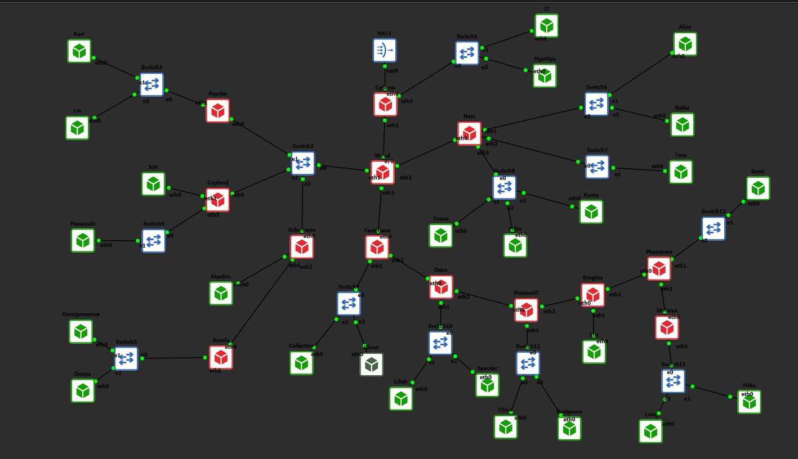


## 2. Pelabelan subnet

Jumlah IP setiap subnet = jumlah host + jumlah interface router di subnet itu. Netmask dipilih dari blok terkecil yang menampung jumlah IP + 2 (NID dan broadcast).

| Subnet | Rute | Jumlah IP | Netmask |
| --- | --- | --- | --- |
| A1 | Cyberia > Switch1 > JJ, MyuMyu | 126 | /25 |
| A2 | Cyberia > Wired | 2 | /30 |
| A3 | Wired > Switch2 > Psyche, Copland, Schumann | 4 | /29 |
| A4 | Wired > Navi | 2 | /30 |
| A5 | Wired > Tachibana | 2 | /30 |
| A6 | Psyche > Switch3 > Karl, Lin | 881 | /22 |
| A7 | Copland > Juri | 32 | /26 |
| A8 | Copland > Switch4 > Masayuki | 301 | /23 |
| A9 | Schumann > Akashic | 4 | /29 |
| A10 | Schumann > Accela | 2 | /30 |
| A11 | Accela > Switch5 > Omnipresence, Denpa | 514 | /22 |
| A12 | Navi > Switch6 > Alice, Reika | 254 | /24 |
| A13 | Navi > Switch7 > Taro | 58 | /26 |
| A14 | Navi > Switch8 > Yasuo, Miho, Kuma | 143 | /24 |
| A15 | Tachibana > Switch9 > Collective, Ghost | 267 | /23 |
| A16 | Tachibana > Deus | 2 | /30 |
| A17 | Deus > Switch10 > Lilith, Specter | 99 | /25 |
| A18 | Deus > Protocol7 | 2 | /30 |
| A19 | Protocol7 > Switch11 > Chisa, Hodgeson | 33 | /26 |
| A20 | Protocol7 > Knights | 2 | /30 |
| A21 | Knights > Eiri | 3 | /29 |
| A22 | Knights > Phantoma | 2 | /30 |
| A23 | Phantoma > Switch12 > Semi | 15 | /27 |
| A24 | Phantoma > Shibuya | 2 | /30 |
| A25 | Shibuya > Switch13 > Lain, Mika | 62 | /26 |
| **Total** | | **2814** | |

## 3. VLSM - Cisco Packet Tracer

_(menyusul - bagian Jude)_

## 4. CIDR - GNS3

### 4.1 Cara hitung

1. Mulai dari subnet terjauh dari NAT (Shibuya), lalu naik router demi router sampai Cyberia.
2. Hasil gabungan = 1 tingkat di atas netmask terbesar yang digabung (contoh: A15 /23 + A16 /30 = B14 /22).
3. Di dalam satu router, subnet terkecil digabung lebih dulu. Link /30 ke router anak masuk ke kelompok router induk, supaya LAN besar tidak ikut digabung berkali-kali.
4. Akar akhirnya **10.72.0.0/18** (B24). Pembagian alamat dilakukan dari akar ke bawah: setiap blok dibelah, bagian yang lebih besar mendapat alamat awal.

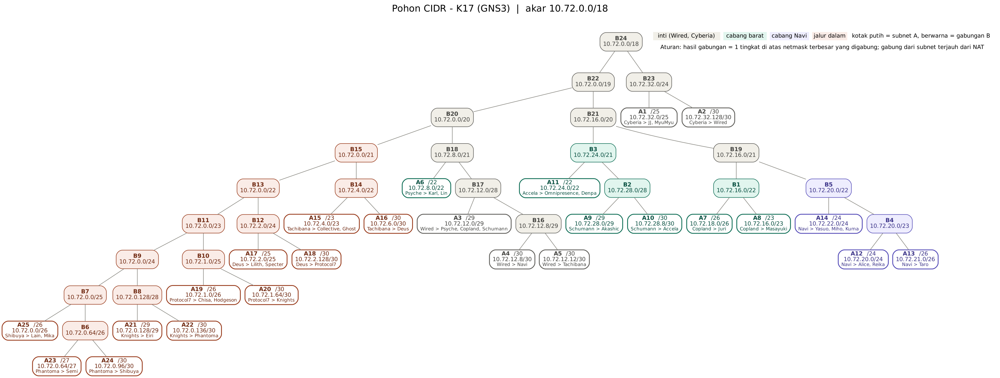

### 4.2 Hasil pembagian IP

Konvensi: IP pertama di setiap subnet untuk router, lalu host berurutan. Di link /30, router yang lebih dekat ke Cyberia mendapat IP pertama.

| Subnet | Rute | Jumlah IP | NID | Netmask | Broadcast | Anggota (IP) |
| --- | --- | --- | --- | --- | --- | --- |
| A1 | Cyberia > Switch1 > JJ, MyuMyu | 126 | 10.72.32.0/25 | 255.255.255.128 | 10.72.32.127 | Cyberia 10.72.32.1, JJ 10.72.32.2, MyuMyu 10.72.32.3 |
| A2 | Cyberia > Wired | 2 | 10.72.32.128/30 | 255.255.255.252 | 10.72.32.131 | Cyberia 10.72.32.129, Wired 10.72.32.130 |
| A3 | Wired > Switch2 > Psyche, Copland, Schumann | 4 | 10.72.12.0/29 | 255.255.255.248 | 10.72.12.7 | Wired 10.72.12.1, Psyche 10.72.12.2, Copland 10.72.12.3, Schumann 10.72.12.4 |
| A4 | Wired > Navi | 2 | 10.72.12.8/30 | 255.255.255.252 | 10.72.12.11 | Wired 10.72.12.9, Navi 10.72.12.10 |
| A5 | Wired > Tachibana | 2 | 10.72.12.12/30 | 255.255.255.252 | 10.72.12.15 | Wired 10.72.12.13, Tachibana 10.72.12.14 |
| A6 | Psyche > Switch3 > Karl, Lin | 881 | 10.72.8.0/22 | 255.255.252.0 | 10.72.11.255 | Psyche 10.72.8.1, Karl 10.72.8.2, Lin 10.72.8.3 |
| A7 | Copland > Juri | 32 | 10.72.18.0/26 | 255.255.255.192 | 10.72.18.63 | Copland 10.72.18.1, Juri 10.72.18.2 |
| A8 | Copland > Switch4 > Masayuki | 301 | 10.72.16.0/23 | 255.255.254.0 | 10.72.17.255 | Copland 10.72.16.1, Masayuki 10.72.16.2 |
| A9 | Schumann > Akashic | 4 | 10.72.28.0/29 | 255.255.255.248 | 10.72.28.7 | Schumann 10.72.28.1, Akashic 10.72.28.2 |
| A10 | Schumann > Accela | 2 | 10.72.28.8/30 | 255.255.255.252 | 10.72.28.11 | Schumann 10.72.28.9, Accela 10.72.28.10 |
| A11 | Accela > Switch5 > Omnipresence, Denpa | 514 | 10.72.24.0/22 | 255.255.252.0 | 10.72.27.255 | Accela 10.72.24.1, Omnipresence 10.72.24.2, Denpa 10.72.24.3 |
| A12 | Navi > Switch6 > Alice, Reika | 254 | 10.72.20.0/24 | 255.255.255.0 | 10.72.20.255 | Navi 10.72.20.1, Alice 10.72.20.2, Reika 10.72.20.3 |
| A13 | Navi > Switch7 > Taro | 58 | 10.72.21.0/26 | 255.255.255.192 | 10.72.21.63 | Navi 10.72.21.1, Taro 10.72.21.2 |
| A14 | Navi > Switch8 > Yasuo, Miho, Kuma | 143 | 10.72.22.0/24 | 255.255.255.0 | 10.72.22.255 | Navi 10.72.22.1, Yasuo 10.72.22.2, Miho 10.72.22.3, Kuma 10.72.22.4 |
| A15 | Tachibana > Switch9 > Collective, Ghost | 267 | 10.72.4.0/23 | 255.255.254.0 | 10.72.5.255 | Tachibana 10.72.4.1, Collective 10.72.4.2, Ghost 10.72.4.3 |
| A16 | Tachibana > Deus | 2 | 10.72.6.0/30 | 255.255.255.252 | 10.72.6.3 | Tachibana 10.72.6.1, Deus 10.72.6.2 |
| A17 | Deus > Switch10 > Lilith, Specter | 99 | 10.72.2.0/25 | 255.255.255.128 | 10.72.2.127 | Deus 10.72.2.1, Lilith 10.72.2.2, Specter 10.72.2.3 |
| A18 | Deus > Protocol7 | 2 | 10.72.2.128/30 | 255.255.255.252 | 10.72.2.131 | Deus 10.72.2.129, Protocol7 10.72.2.130 |
| A19 | Protocol7 > Switch11 > Chisa, Hodgeson | 33 | 10.72.1.0/26 | 255.255.255.192 | 10.72.1.63 | Protocol7 10.72.1.1, Chisa 10.72.1.2, Hodgeson 10.72.1.3 |
| A20 | Protocol7 > Knights | 2 | 10.72.1.64/30 | 255.255.255.252 | 10.72.1.67 | Protocol7 10.72.1.65, Knights 10.72.1.66 |
| A21 | Knights > Eiri | 3 | 10.72.0.128/29 | 255.255.255.248 | 10.72.0.135 | Knights 10.72.0.129, Eiri 10.72.0.130 |
| A22 | Knights > Phantoma | 2 | 10.72.0.136/30 | 255.255.255.252 | 10.72.0.139 | Knights 10.72.0.137, Phantoma 10.72.0.138 |
| A23 | Phantoma > Switch12 > Semi | 15 | 10.72.0.64/27 | 255.255.255.224 | 10.72.0.95 | Phantoma 10.72.0.65, Semi 10.72.0.66 |
| A24 | Phantoma > Shibuya | 2 | 10.72.0.96/30 | 255.255.255.252 | 10.72.0.99 | Phantoma 10.72.0.97, Shibuya 10.72.0.98 |
| A25 | Shibuya > Switch13 > Lain, Mika | 62 | 10.72.0.0/26 | 255.255.255.192 | 10.72.0.63 | Shibuya 10.72.0.1, Lain 10.72.0.2, Mika 10.72.0.3 |

### 4.3 Konfigurasi GNS3

- Router: image `ardhptr21/debinet`. End device: image `ardhptr21/alpinet`. Console telnet.
- Port router: `eth0` selalu ke arah Cyberia/NAT1, port berikutnya ke cabang di bawahnya.
- IP diisi lewat **Edit config** (`/etc/network/interfaces`), lihat `nodes/<Node>/interfaces` atau `perquest-scripts/soal_1.sh`.
- Rute disimpan di `/root/soal_5.sh` dan dijalankan otomatis saat boot lewat baris `up bash /root/startup.sh` pada network config. Hasil setiap boot tercatat di `/root/startup.log`.
- `/root` dan `/etc/network` adalah folder persisten, jadi konfigurasi bertahan setelah node dimatikan.

### 4.4 Routing (24 rute)

Karena setiap cabang sudah menjadi satu blok gabungan, setiap router cukup punya satu rute per cabang di bawahnya. Router paling bawah cukup memakai default route.

| Router | Tujuan | Via | Alasan |
| --- | --- | --- | --- |
| Cyberia | 10.72.0.0/19 | 10.72.32.130 | Seluruh blok di belakang Wired (B22) |
| Wired | default | 10.72.32.129 | Keluar ke router di atasnya (arah NAT) |
| Wired | 10.72.8.0/22 | 10.72.12.2 | A6, LAN Psyche |
| Wired | 10.72.16.0/22 | 10.72.12.3 | B1, cabang Copland (A7+A8) |
| Wired | 10.72.24.0/21 | 10.72.12.4 | B3, cabang Schumann + Accela (A9, A10, A11) |
| Wired | 10.72.20.0/22 | 10.72.12.10 | B5, cabang Navi (A12, A13, A14) |
| Wired | 10.72.0.0/21 | 10.72.12.14 | B15, seluruh jalur dalam dari Tachibana |
| Psyche | default | 10.72.12.1 | Keluar ke router di atasnya (arah NAT) |
| Copland | default | 10.72.12.1 | Keluar ke router di atasnya (arah NAT) |
| Schumann | default | 10.72.12.1 | Keluar ke router di atasnya (arah NAT) |
| Schumann | 10.72.24.0/22 | 10.72.28.10 | A11, LAN Accela |
| Accela | default | 10.72.28.9 | Keluar ke router di atasnya (arah NAT) |
| Navi | default | 10.72.12.9 | Keluar ke router di atasnya (arah NAT) |
| Tachibana | default | 10.72.12.13 | Keluar ke router di atasnya (arah NAT) |
| Tachibana | 10.72.0.0/22 | 10.72.6.2 | B13, semua di belakang Deus |
| Deus | default | 10.72.6.1 | Keluar ke router di atasnya (arah NAT) |
| Deus | 10.72.0.0/23 | 10.72.2.130 | B11, semua di belakang Protocol7 |
| Protocol7 | default | 10.72.2.129 | Keluar ke router di atasnya (arah NAT) |
| Protocol7 | 10.72.0.0/24 | 10.72.1.66 | B9, semua di belakang Knights |
| Knights | default | 10.72.1.65 | Keluar ke router di atasnya (arah NAT) |
| Knights | 10.72.0.0/25 | 10.72.0.138 | B7, semua di belakang Phantoma |
| Phantoma | default | 10.72.0.137 | Keluar ke router di atasnya (arah NAT) |
| Phantoma | 10.72.0.0/26 | 10.72.0.98 | A25, LAN Shibuya |
| Shibuya | default | 10.72.0.97 | Keluar ke router di atasnya (arah NAT) |

Di Wired juga dimatikan `send_redirects`, karena Psyche, Copland, dan Schumann berbagi satu segmen (A3) dengan Wired. Tanpa itu, Wired mengirim ICMP Redirect saat paket keluar-masuk lewat eth1 yang sama.

### 4.5 NAT di Cyberia (soal 7)

Cyberia mendapat IP `eth0` dari NAT1 lewat DHCP, lalu menjalankan `/root/soal_7.sh`:

```
iptables -t nat -A POSTROUTING -s 10.72.0.0/18 -o eth0 -j MASQUERADE
```

## 5. Pengujian GNS3

### 5.1 Autostart dan rute setiap router

Setiap router diuji dengan Stop lalu Start, kemudian `startup.log`, `ip -br a`, dan ping diperiksa.

**Cyberia: startup.log, rute, MASQUERADE, ping 8.8.8.8**

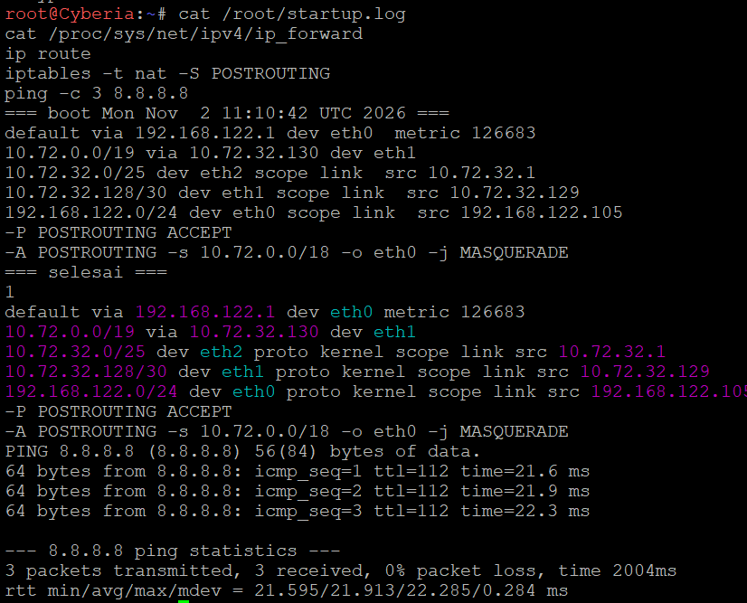

**Wired: startup.log dan 5 rute cabang**

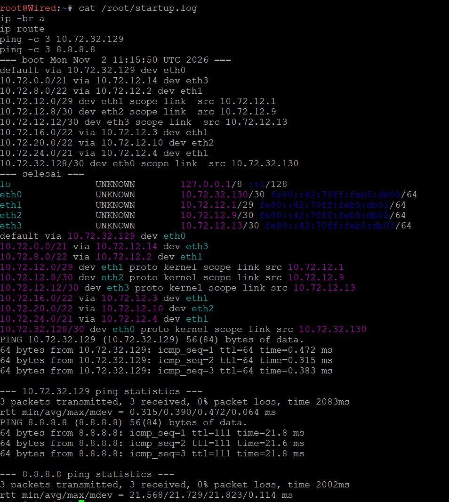

**Psyche**


**Copland**


**Schumann**

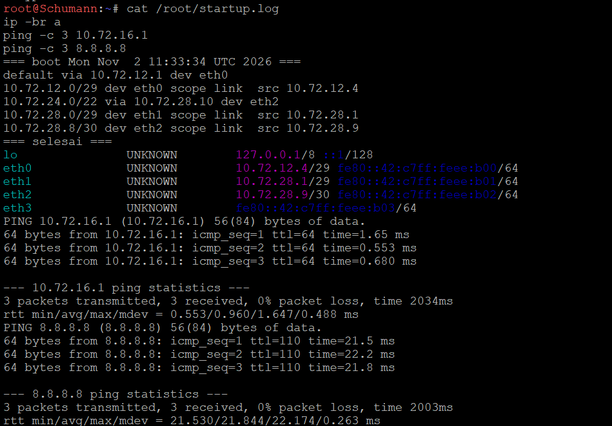

**Accela**

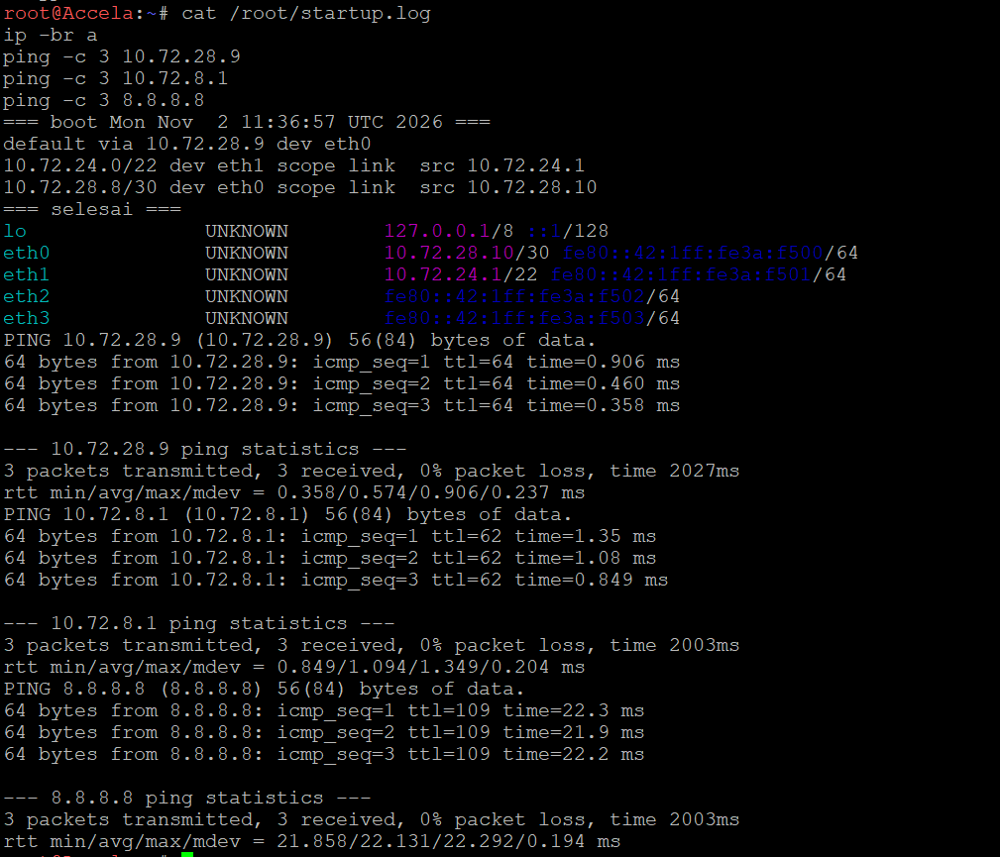

**Navi**

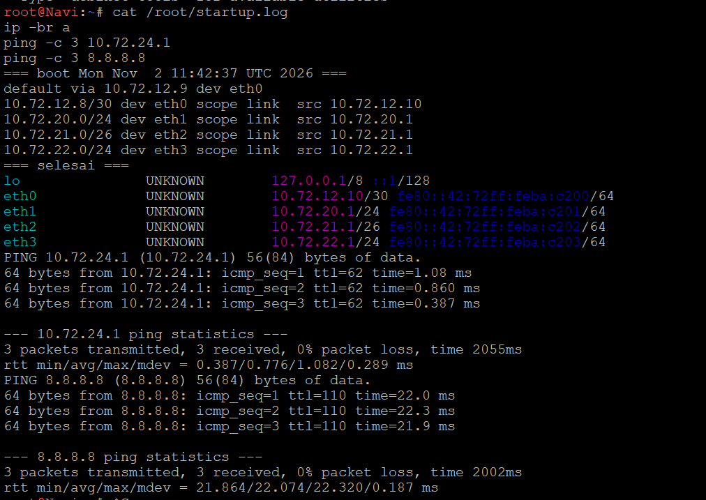

**Tachibana**

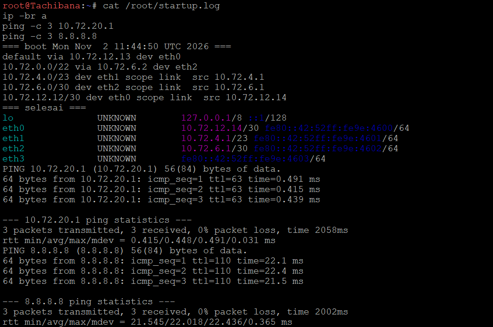

**Deus**


**Protocol7**


**Knights**

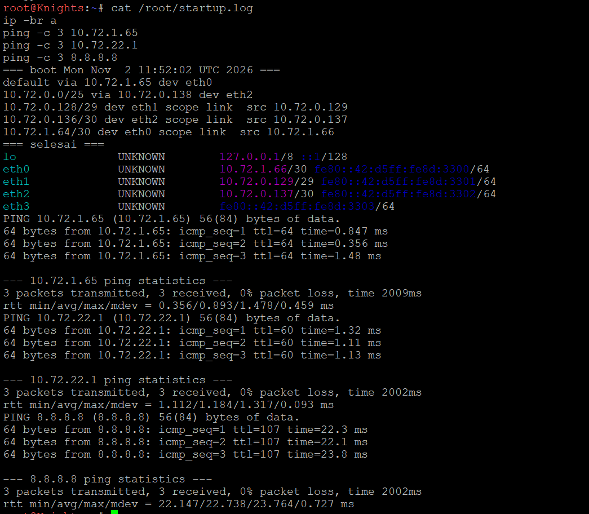

**Phantoma**

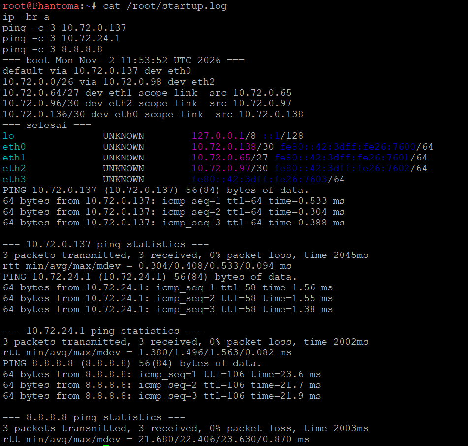

**Shibuya**


**Wired setelah restart: ICMP redirect mati otomatis**

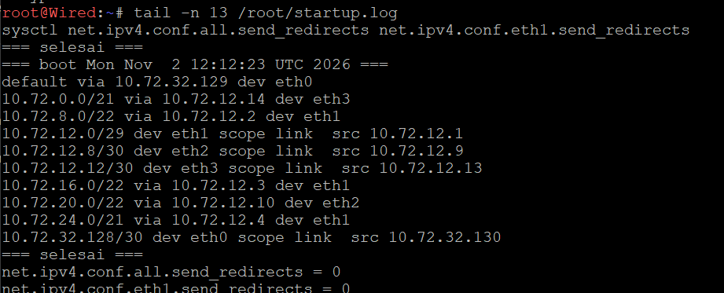

### 5.2 Konektivitas seluruh node

Script `perquest-scripts/uji_konektivitas.sh` dijalankan di Lain (node terdalam): ping ke satu IP dari setiap 38 node + internet.


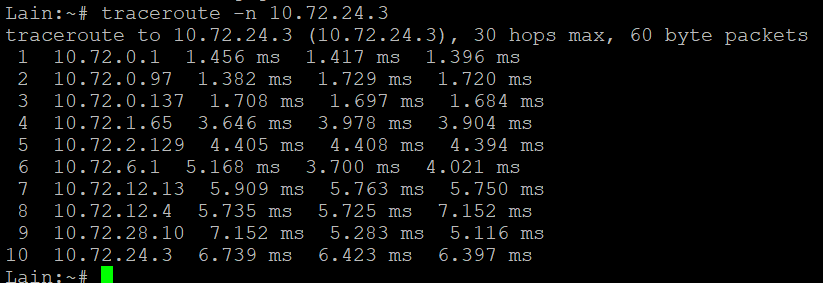

Uji restart total: semua node dimatikan, project diekspor, lalu semua node dinyalakan ulang tanpa konfigurasi manual.

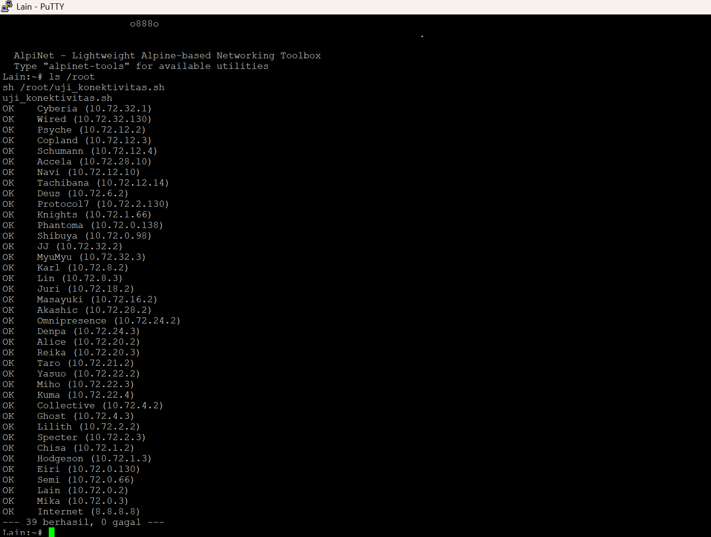

## 6. Kendala

| Kendala | Penyebab | Solusi |
| --- | --- | --- |
| Ping Copland ke LAN Psyche menampilkan `Redirect Host` dan packet loss | Wired meneruskan paket keluar lewat interface yang sama (segmen A3) sehingga mengirim ICMP Redirect | `send_redirects=0` di Wired, dimasukkan ke `soal_5.sh` supaya ikut boot |
| Pesan `Appliance.Audit is required` di GNS3 | Akun praktikan tidak boleh membuka katalog appliance | Diabaikan; template debinet, alpinet, NAT, dan switch tetap tersedia |
| Export project mengharuskan semua node mati | Ketentuan GNS3 | Semua node dimatikan, diekspor, lalu dinyalakan ulang; konektivitas tetap 39/0 |
